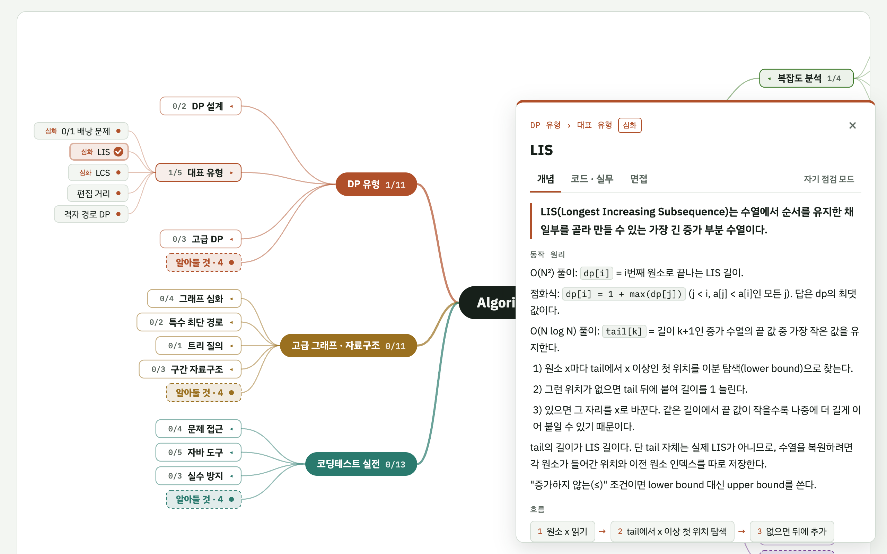
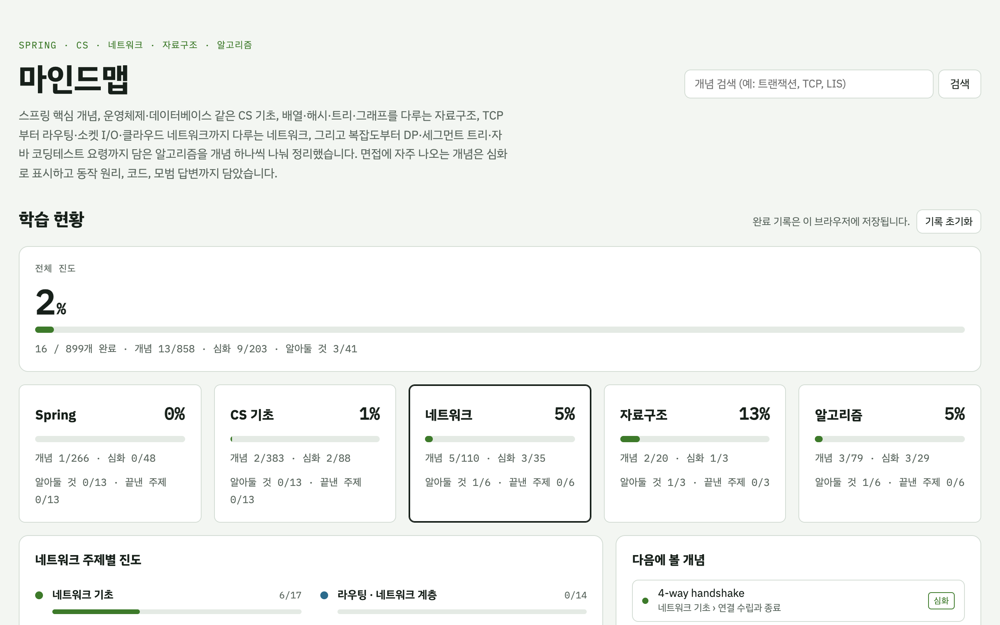
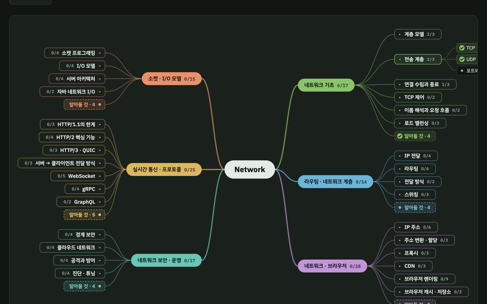
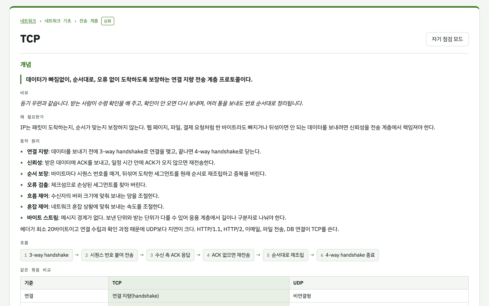
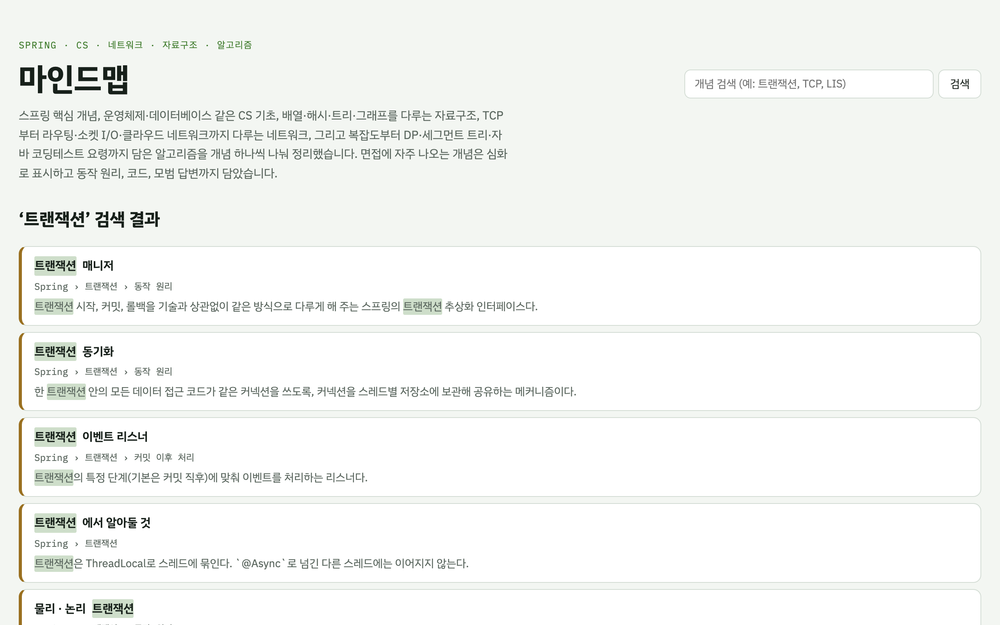
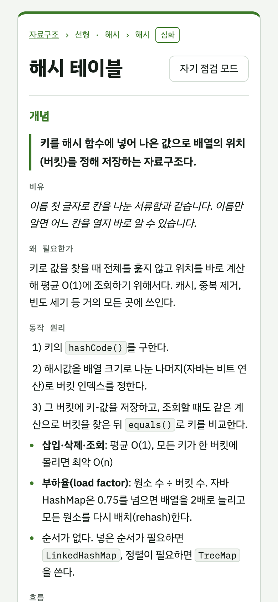

# 마인드맵

백엔드 면접과 코딩테스트 준비를 위해 Spring · CS 기초 · 네트워크 · 자료구조 · 알고리즘 개념을 마인드맵으로 정리한 학습 페이지입니다.

**바로 보기:** https://mindmap-xxxx.vercel.app <!-- Vercel 배포 후 주소로 교체 -->

## 화면



| 학습 현황 | 다크 모드 |
|---|---|
|  |  |
| **개념 단독 페이지** (`/net/tcp`) | **검색** |
|  |  |

<details>
<summary>휴대폰 화면</summary>



</details>

## 탭 구성

| 탭 | 주제 | 개념 | 다루는 범위 |
|---|---|---|---|
| Spring | 13 | 266 | IoC·DI, Bean·컨테이너, AOP, MVC, 트랜잭션, JPA, Boot, Security, 서버·동시성, 테스트, Batch, 캐시·메시징, 외부 연동·회복성 |
| CS 기초 | 13 | 383 | 운영체제, 웹·HTTP, 데이터베이스, 자바·JVM, 자바 동시성, 객체지향·설계, 시스템 설계, 보안, Redis, 분산 시스템, 인프라·배포, 컴퓨터 구조, 관측성 |
| 네트워크 | 6 | 110 | 네트워크 기초, 라우팅·네트워크 계층, 네트워크·브라우저, 소켓·I/O 모델, 실시간 통신·프로토콜, 네트워크 보안·운영 |
| 자료구조 | 3 | 20 | 선형·해시, 트리·힙, 그래프 |
| 알고리즘 | 6 | 79 | 복잡도·기초, 핵심 알고리즘, 배열·문자열 기법, DP 유형, 고급 그래프·자료구조, 코딩테스트 실전 |

면접에 자주 나오는 개념은 **심화**로 표시되어 있습니다.

## 기능

- **마인드맵:** 주제 → 묶음 → 개념 순서로 접고 펼칩니다.
- **설명 카드:** 개념을 누르면 `개념` · `코드 · 실무` · `면접` 탭으로 나뉜 설명이 열립니다.
  - 정의, 비유, 동작 원리, 흐름, 같은 묶음 비교 표
  - 코드 예시, 실무 사례, 주의할 점, 흔한 오해
  - 30초 답변, 면접 질문, 꼬리 질문, 관련 개념 링크 (다른 탭으로도 이동)
- **자기 점검 모드:** 답변을 가려 두고 눌러야 보이게 합니다.
- **학습 현황:** 개념별 완료 체크, 탭·주제별 진도, 다음에 볼 개념을 추천합니다.
- **전체 노트:** 현재 탭의 모든 개념을 한 페이지로 훑어봅니다.
- **개념별 주소:** `/net/tcp`처럼 개념마다 주소가 있어 링크로 공유할 수 있습니다.
- **검색:** 개념 이름, 정의, 면접 질문으로 검색합니다.

> 완료 기록과 설정은 보는 사람의 브라우저(localStorage)에만 저장됩니다. 다른 기기나 브라우저와는 공유되지 않습니다.

## 기술 스택

Next.js 16 (App Router, Cache Components) · React 19 · TypeScript · Vitest · Playwright

- 개념 페이지 900여 개를 빌드할 때 정적으로 만들어 둡니다. 개념마다 고유 주소(`/net/tcp`)가 있어 링크로 공유하거나 검색 엔진에 노출할 수 있습니다.
- 마인드맵에서 개념을 누르면 지금 화면 위에 설명 카드가 뜨고 주소도 바뀝니다(parallel + intercepting routes). 그 주소로 바로 들어오면 단독 개념 페이지가 열립니다.
- 브라우저에는 탭의 제목 뼈대만 보내고, 개념 본문은 서버에서 HTML로 그려 보냅니다.

## 구조

```
app/
  page.tsx                      대시보드
  [tab]/layout.tsx              대시보드 + 마인드맵 (탭마다)
  [tab]/page.tsx                전체 노트
  [tab]/[slug]/page.tsx         개념 단독 페이지 (정적 생성, 메타데이터)
  [tab]/@panel/(.)[slug]/       마인드맵 위 설명 카드 (가로챈 라우트)
  search/page.tsx               검색
  sitemap.ts, robots.ts
components/
  mindmap/layout.ts             마인드맵 배치 계산 (순수 함수)
  mindmap/MindMap.tsx           SVG 렌더링과 조작
  concept/                      설명 카드, 개념 본문, 완료 버튼
  dashboard/Dashboard.tsx       학습 현황
lib/
  content.ts                    콘텐츠 조회와 클라이언트용 뼈대
  view.ts                       슬러그 → 개념, 이전·다음 계산
  progress/store.ts             완료 기록 저장소 (localStorage, 서버 동기화로 교체 가능한 인터페이스)
  progress/migrate.ts           v1 정적 사이트의 완료 기록 이전
content/
  types.ts                      데이터 타입
  index.ts                      탭과 주제 목록
  <탭>/<탭>-<n>.ts              주제 하나
scripts/
  validate.ts                   콘텐츠 검사 (빌드 전 자동 실행)
  build-search.ts               검색 인덱스 생성 (빌드 전 자동 실행)
  convert.ts                    v1 데이터 변환 (한 번 쓰고 끝)
```

탭 키는 `spring`, `cs`, `net`, `ds`, `algo`입니다.

### 개념 데이터 형식

```ts
// content/net/net-1.ts
const topic: Topic = {
  key: 'net-1',                      // 파일 이름과 같게
  name: '주제 이름',
  must: ['이 주제에서 알아둘 것'],
  groups: [{
    name: '묶음 이름',
    compare: { cols: ['기준', '개념 A', '개념 B'], rows: [['항목', '...', '...']] },  // 선택
    concepts: [{
      id: 'net/gaenyeom-ireum',        // `${탭}/${slug}`, 완료 기록의 키
      slug: 'gaenyeom-ireum',          // 주소. 한 번 정하면 바꾸지 않는다
      title: '개념 이름',
      deep: true,                      // 심화 표시
      def: '한 문장 정의',
      how: ['설명 문단', '- 라벨: 목록 항목', '1) 단계'],  // `코드`는 백틱으로
      code: '코드 예시', codeLang: 'java',
      answer: '30초 답변', qa: ['면접 질문', '모범 답변'], followUps: [['꼬리 질문', '답']],
      related: ['net/tcp', 'cs/seokit-beureikeo'],      // 다른 탭의 개념도 id로 연결
      // 그 밖에 why, analogy, flow, use, warn, myth
    }],
  }],
};
```

필드 설명은 `content/types.ts`에 있습니다.

### 주제 추가하기

1. `content/<탭>/<탭>-<n>.ts`를 만듭니다. 슬러그는 `lib/slug.ts`의 `slugify(제목)`으로 만들면 기존 규칙과 같아집니다.
2. `content/index.ts`에 import를 추가하고 해당 탭의 `topics` 배열에 넣습니다.
3. `npm run validate`로 검사합니다. id 중복, 같은 탭 안 제목 중복, 없는 관련 개념, 비교 표 칸 수를 확인합니다.

> 완료 기록은 개념 `id`로 저장되므로 제목이나 주제를 바꿔도 기록이 유지됩니다. `id`와 `slug`만 바꾸지 않으면 됩니다.

## 개발

```sh
npm install
npm run dev          # http://localhost:3000
npm test             # 단위 테스트 (Vitest)
npm run build        # 콘텐츠 검사 → 검색 인덱스 → 빌드
npm run test:e2e     # 빌드 후 화면 테스트 (Playwright, 로컬 Chrome 사용)
```

## 배포

Vercel에 이 저장소를 연결하면 `main`에 push할 때마다 자동으로 다시 배포됩니다. 빌드 설정은 기본값(Next.js)을 그대로 씁니다.
사이트 주소를 sitemap과 메타데이터에 쓰려면 Vercel 환경 변수 `NEXT_PUBLIC_SITE_URL`을 설정합니다. 설정하지 않으면 Vercel 운영 도메인을 씁니다.

빌드 과정 없는 v1 정적 사이트는 `v1-static` 태그에 남아 있습니다.
